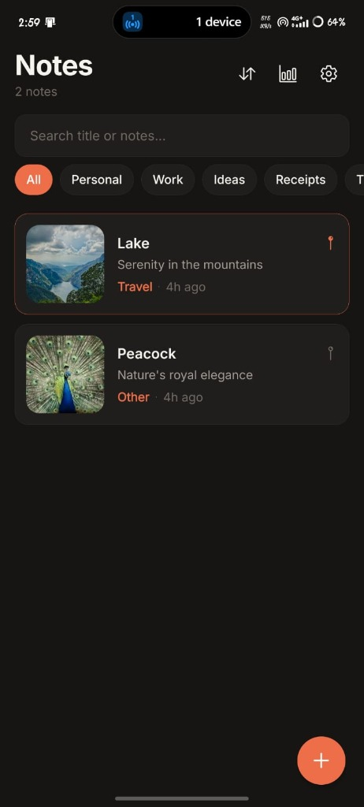
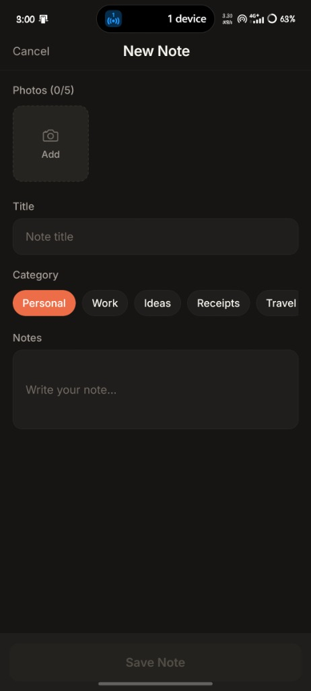
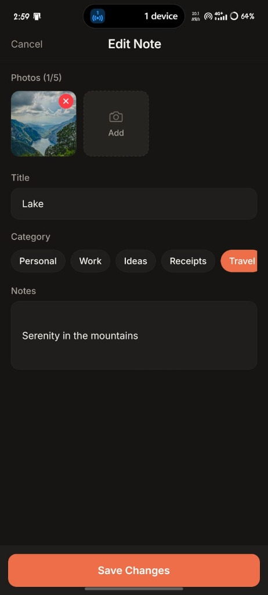
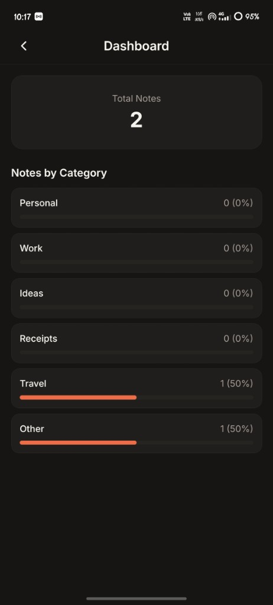
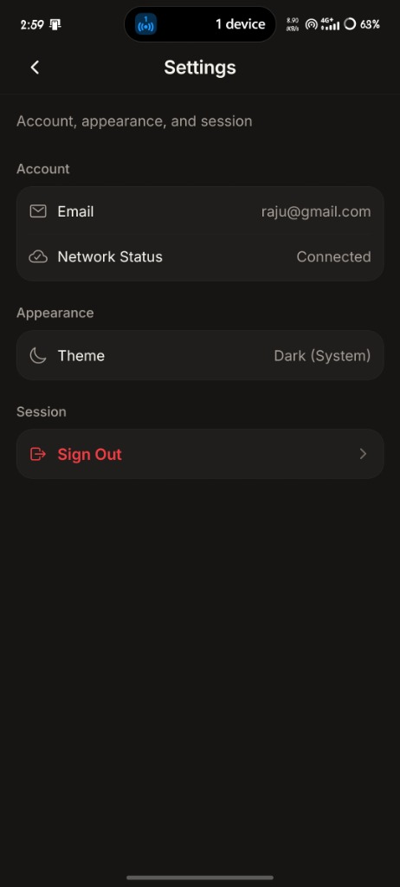

# Smart Capture

A mobile notes and media capture application built with React Native, Expo, and Supabase.

**GitHub Repository:** https://github.com/jkxroot/smart-capture-notes


**Google Drive** (APK, Screenshots & Demo Video): https://drive.google.com/drive/folders/1YSlYqsNt1-ayXJpTjFlUZ1kch2KNXF6u?usp=sharing&pli=1

---

## Screenshots

Actual application screenshots captured on a physical device:

| Notes List & Search | New Note Form (0/5 Photos) | Edit Note & Photos (1/5) |
|:---:|:---:|:---:|
|  |  |  |

| Category Analytics Dashboard | Account & Network Settings |
|:---:|:---:|
|  |  |

---

## Features

### Core Capabilities
- **Authentication & Native Session Persistence**:
  - Email and password sign-up and sign-in with client-side form validation.
  - Native session persistence via `@react-native-async-storage/async-storage` (`autoRefreshToken: true`, `persistSession: true`).
  - Route protection through `expo-router` with a zero-flicker splash screen transition.
  - Clean, error-free sign-out flow clearing cached URLs, outbox records, and in-flight requests.
- **Multi-Photo Attachments (Up to 5 Photos)**:
  - Attach up to 5 images per note using device camera or photo library.
  - Client-side compression via `expo-image-manipulator` (resizes to 1600px width with 0.7 JPEG quality, keeping uploads under 800KB).
  - Individual thumbnail previews with one-tap removal badges.
  - Fullscreen pinch-to-zoom image viewer modal.
- **Offline Outbox & SQLite Sync Queue**:
  - Local database powered by `expo-sqlite` (WAL journal mode).
  - When offline, note creations, edits, and deletions are saved to a local SQLite outbox queue.
  - Real-time network listener (`@react-native-community/netinfo`) triggers background synchronization as soon as connectivity is restored.
- **Private Cloud Storage & Secure Access**:
  - Zero public bucket exposure: all assets live in a private Supabase Storage bucket (`record-images`).
  - Row Level Security enforces folder isolation (`{user_id}/{record_id}.jpg`).
  - Time-limited signed URLs (1-hour expiry) cached in memory with proactive refresh before expiration.
- **Full-Text Search (FTS) & Filtering**:
  - PostgreSQL generated `tsvector` column (`search_tsv`) with GIN indexing for English stemming.
  - Seamless fallback to sanitized `ILIKE` pattern matching for special character queries (`%`, `_`, `\`, `,`).
  - Category filter pills (*Personal*, *Work*, *Ideas*, *Receipts*, *Travel*, *Other*).
  - Note pinning and sorting menu (*Newest First*, *Oldest First*, *Title A–Z*).
- **Export & System Sharing**:
  - High-resolution share card generated off-screen with `react-native-view-shot` (includes 4:3 cover photo, title, category, date, notes body, and branding) exported via `expo-sharing`.
  - Native plain-text sharing fallback via React Native's `Share.share`.
- **Category Analytics Dashboard**:
  - Visual metrics showing total notes and proportional distribution bars per category with direct tap-to-filter navigation.

---

## Tech Stack

| Technology | Version | Purpose | Rationale |
|---|---|---|---|
| Expo | ~58.0.21 | Managed mobile framework | Delivers consistent native capabilities without Xcode/Android Studio overhead. |
| React Native | 0.88.1 | Mobile UI platform | Native component rendering with high responsiveness. |
| TypeScript | ~6.0.3 | Static typing | Strict type checking across contexts, models, and API boundaries. |
| expo-router | ~58.0.28 | File-based navigation | Type-safe declarative routing, deep links, and navigation guards. |
| @supabase/supabase-js | ^2.118.0 | Auth, Database, Storage | Relational PostgreSQL with native Row Level Security (RLS) and private object storage. |
| @react-native-async-storage/async-storage | 2.2.0 | Session storage | Persists user auth state between application launches. |
| expo-sqlite | ~58.0.0 | Offline persistence | High-performance local SQLite storage for offline caching and outbox sync. |
| expo-image-picker | ~58.0.10 | Camera & gallery | Standardized permission handling and asset picking. |
| expo-image-manipulator | ~58.0.16 | Image pre-processing | Client-side compression and resizing to prevent bandwidth exhaustion. |
| expo-file-system & base64-arraybuffer | ~58.0.13 / ^1.0.2 | Binary uploads | Deterministic `ArrayBuffer` conversion avoiding unstable mobile `Blob`/`FormData` implementations. |
| expo-image | ~58.0.18 | Image rendering | Fast disk and memory caching with smooth crossfade transitions. |
| expo-sharing & react-native-view-shot | ~58.0.21 / 6.1.1 | Share card export | Off-screen view snapshot capture and native share sheet triggering. |
| @react-native-community/netinfo | 12.0.1 | Network monitoring | Real-time connection detection driving offline banners and sync. |
| Jest & ts-jest | ^29.2.5 | Unit test framework | Automated test verification for utilities, validation, and math. |

---

## Quick Start (Under 5 Minutes)

### 1. Prerequisites
- Node.js 18+ (tested on Node 22 and 24)
- npm or pnpm
- Expo Go on iOS/Android or an emulator running
- A Supabase project

### 2. Install Dependencies
```bash
git clone https://github.com/jkxroot/smart-capture-notes.git
cd smart-capture-notes
npm install
```

### 3. Environment Configuration
Create a `.env` file in the project root:
```bash
cp .env.example .env
```
Populate `.env` with your Supabase credentials:
```env
EXPO_PUBLIC_SUPABASE_URL=https://your-project-id.supabase.co
EXPO_PUBLIC_SUPABASE_ANON_KEY=sb_publishable_your_key_here
```
*(Both legacy JWT anon keys and modern `sb_publishable_...` keys are fully supported).*

### 4. Database Setup
Run the SQL migration in your Supabase **SQL Editor** (see the [Supabase Setup](#supabase-setup) section below).

### 5. Start Development Server
```bash
npx expo start -c
```
Scan the QR code with Expo Go (Android) or the native Camera app (iOS).

---

> Note: In the Supabase Dashboard under **Authentication > Email Auth**, disable "Confirm email" for immediate evaluation during local development.

---

## Project Structure

```
smart-capture/
├── app/                           # Expo Router file-based route definitions
│   ├── _layout.tsx                # Font loading, splash orchestration, global auth navigation guard
│   ├── (auth)/                    # Unauthenticated route group
│   │   ├── _layout.tsx            # Headerless stack layout
│   │   ├── login.tsx              # Email/password authentication form
│   │   └── signup.tsx             # New account registration form
│   └── (app)/                     # Protected route group (requires active session)
│       ├── _layout.tsx            # Header configuration, RecordsProvider, tabs
│       ├── index.tsx              # Note list, search, category chips, sort menu, FAB
│       ├── add.tsx                # Multi-photo note creation form (0/5 photos)
│       ├── record/
│       │   └── [id].tsx           # Record detail view, fullscreen image, pin, share, delete
│       ├── edit/
│       │   └── [id].tsx           # Record update form with multi-photo management
│       ├── dashboard.tsx          # Category metrics and distribution bars
│       └── settings.tsx           # Account email display, network info, sign out
├── src/
│   ├── components/                # Reusable design system primitives
│   │   ├── ActionSheet.tsx        # Bottom modal action selector
│   │   ├── Button.tsx             # Primary, secondary, outline, danger button variants
│   │   ├── Card.tsx               # Hairline-bordered surface container
│   │   ├── Chip.tsx               # Category filter pill with selected accent state
│   │   ├── ConfirmDialog.tsx      # Modal alert for destructive actions (valid alert role)
│   │   ├── EmptyState.tsx         # Graphic empty placeholders for lists and search
│   │   ├── ImageAttachments.tsx   # Multi-photo carousel with add/delete triggers
│   │   ├── IconButton.tsx         # Accessible touch target icon button (min 44x44)
│   │   ├── ImageViewer.tsx        # Fullscreen zoomable image viewer modal
│   │   ├── Input.tsx              # Labeled text field with inline error and character counter
│   │   ├── OfflineBanner.tsx      # Network status warning banner
│   │   ├── RecordCard.tsx         # List item card with thumbnail, pin toggle, and metadata
│   │   ├── Screen.tsx             # Safe area, keyboard avoidance, and max-width layout wrapper
│   │   ├── ShareCard.tsx          # Off-screen component for generating high-res share cards
│   │   ├── Skeleton.tsx           # Pulse-animated loading placeholder
│   │   └── SortMenu.tsx           # Bottom sheet sort order selector
│   ├── context/                   # Shared React application state
│   │   ├── AuthContext.tsx        # Supabase auth session, profile, signout cleanup
│   │   ├── NetworkContext.tsx     # Real-time online/offline monitoring
│   │   ├── RecordsContext.tsx     # Record collections, pagination, search, optimistic pin, rollback
│   │   ├── ThemeContext.tsx       # System theme detection, color tokens, typography
│   │   └── ToastContext.tsx       # Transient non-blocking notifications
│   ├── lib/
│   │   └── supabase.ts            # Configured Supabase client with AsyncStorage integration
│   ├── services/                  # Stateless business logic and API callers
│   │   ├── authService.ts         # Supabase Auth SDK wrappers
│   │   ├── imageService.ts        # Image picker invocation and client-side compression
│   │   ├── localDb.ts             # Local SQLite outbox queue & record cache
│   │   ├── recordService.ts       # Database CRUD queries, FTS, ilike search, category counts
│   │   ├── shareService.ts        # expo-sharing & react-native-view-shot export logic
│   │   └── storageService.ts      # Binary upload, signed URL caching, and file deletion
│   ├── theme/                     # Design tokens
│   │   ├── colors.ts              # Warm terracotta palette (light and dark)
│   │   ├── spacing.ts             # Spacing scale and border radius definitions
│   │   └── typography.ts          # Inter font configurations and text hierarchy
│   ├── types/                     # TypeScript definitions
│   │   └── record.ts              # RecordItem model, categories, sort options
│   └── utils/                     # Pure helper functions
│       ├── __tests__/             # Automated unit tests (Jest)
│       │   ├── errors.test.ts
│       │   ├── escape.test.ts
│       │   ├── images.test.ts
│       │   └── validation.test.ts
│       ├── errors.ts              # Error categorization and human-readable message mapping
│       ├── escape.ts              # PostgREST ilike pattern escaping (%, _, \, commas)
│       ├── formatDate.ts          # Localized relative and full date formatting
│       └── validation.ts          # Client-side form validators
├── supabase/
│   ├── migrations/                # Database migration scripts
│   └── schema.sql                 # Canonical database and storage migration
├── docs/                          # Architecture, testing, and limitation documentation
│   ├── ARCHITECTURE.md            # Data flow diagrams, storage, and security model
│   ├── LIMITATIONS.md             # Trade-offs, current constraints, and roadmap
│   ├── TESTING.md                 # Manual verification checklist and verification steps
│   └── screenshots/               # Application screenshots
├── app.json                       # Expo configuration
├── eas.json                       # EAS build profile for Android APK
├── package.json                   # Dependencies and scripts
└── tsconfig.json                  # Strict TypeScript configuration
```

---

## Assignment Coverage & Features

| Requirement | Status | Implementation Details |
|---|---|---|
| Camera & gallery capture + preview | Done | `expo-image-picker` with permission handling and camera/library selector |
| Title, notes, and category | Done | Constraints: Title 1–100 chars, Notes $\le$ 2000 chars, 6 distinct categories |
| Persist after restart | Done | Supabase Auth session via `AsyncStorage` + Postgres persistent store |
| List with thumbnails, view / edit / delete | Done | 84x84 thumbnails on mobile, 4:3 cover on wide, full CRUD with rollback |
| Search + category filter | Done | Debounced search across title/notes + category filter chips |
| Error handling & permissions | Done | Sanitized human error messages, permission denial settings prompts |
| Cross-platform (React Native / Expo) | Done | Runs in Expo Go on iOS & Android, standalone APK build configured |
| Architecture & limitations docs | Done | [docs/ARCHITECTURE.md](docs/ARCHITECTURE.md), [docs/LIMITATIONS.md](docs/LIMITATIONS.md) |
| **Bonus: Share / export record** | Done | `react-native-view-shot` image card export + `Share.share` text export |
| **Bonus: Offline image compression** | Done | Resizes to 1600px width with 0.7 JPEG quality (< 800KB files) |
| **Bonus: Category analytics dashboard** | Done | Visual distribution bars and tap-to-filter navigation |
| **Bonus: Multi-image attachments** | Done | Attach up to 5 images per note with horizontal carousel & removal badges |
| **Bonus: Offline SQLite outbox queue** | Done | Local SQLite outbox via `expo-sqlite` syncing automatically on reconnect |
| **Bonus: Full-text search (FTS)** | Done | PostgreSQL `search_tsv` tsvector generated column with GIN index |
| **Bonus: Automated unit tests** | Done | Jest test suite covering error translation, escape math, and validation |

---

## Verification and Testing

Execute the following verification commands from the project root:

```bash
# 1. Type Check (Strict TypeScript validation)
npx tsc --noEmit

# 2. Run Automated Unit Tests (Jest)
npm test

# 3. Dead Code & Unused Parameter Audit
npx tsc --noEmit --noUnusedLocals --noUnusedParameters

# 4. Production Bundle Export Check
npx expo export -p android -p ios --output-dir temp_export
```

For the step-by-step test plan covering authentication, CRUD, image manipulation, search edge cases, and offline behavior, refer to [docs/TESTING.md](docs/TESTING.md).

---

## License

MIT License. Designed and engineered for evaluation.
